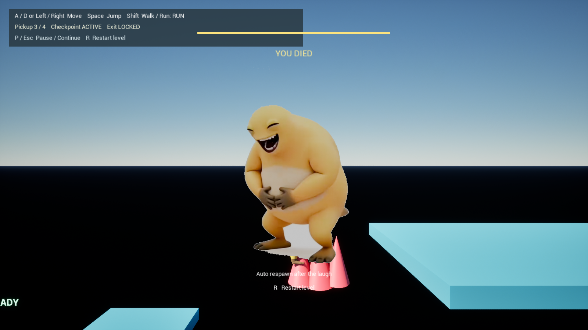

# 奶蛙冒险

横版闯关小游戏，第三关是正俯视迷宫，第四关滑雪，另有两个独立子模式。主角奶蛙是「奶龙」的二创形象，非官方。

最早用 C++ / SFML 写了原型，现在用 UE5 重做。角色和每一颗蛋都由 Python 脚本在 Blender 里生成，改参数重跑就更新，不用手动雕。

## 玩法

### 1-1

四种机关：隐藏尖刺、弹跳板、限时平台、开关移动平台。8 个检查点，摔死就地复活，机关跟着复位。终点要先拿到指定的那颗拾取物。



### 2-1 / 2-2 / 2-3

打弹弓。奶蛙蹲左边，用奶蛋当子弹，把右边搭好的结构打塌，砸中目标蛋算赢。按住左键在蛋上拖出方向和力度，松手发射。

- **2-1 斩首**：一根细柱子顶着目标蛋，只有基础奶蛋。
- **2-2 选蛋**：五种蛋随便挑。
- **2-3 综合**：一座塔，得换着蛋打。

五种奶蛋：基础、奶鸡（飞行中再点一下往上窜）、奶鼠（再点一下裂成三枚）、豆奶（判定球更大）、奶茶（落地后四周炸开）。

结构块是真刚体，撞侧面会转，撞正中几乎不转，撞下沿往上弹。同一发打两次结果不会完全一样。

打空退你一颗蛋。蛋打光目标还在就判失败，按 `R` 重来。

### 3-1 / 3-2

俯视迷宫，格子走位。放奶蛋炸开软砖和对手，把金蛋捡齐，再从出口出去。三条命，自己被炸到也扣。

- **3-1 教学**：11×9 小图，没有迷雾，看得到全图。
- **3-2 夜巡**：23×17 大图，带战争迷雾，走过的地方才记得住，左上角小地图同步。

四种弹型：标准十字、豆奶大十字、奶茶圆爆、奶鼠分裂。机关有传送门、踩板金库门、传送带、尖刺、断裂地板。

金蛋集齐后对手进入狂暴，追得更急。

### 4-1

滑雪。奶蛙自动沿雪坡往前，玩家只管什么时候跳、空中转几圈。雪崩一直在后面追。

- 空格单按就起跳，跳多高是固定的，按住没用。
- 空中按 `A` / `D` 转，最多两圈。落地时角度要落在整圈的 ±45 度内，否则摔倒并被雪崩追近一段；正好一圈升一档速，两圈升两档。
- 路上有金币、树、石头、冰缝。中途能骑袋鼠，一段距离后自动下来。
- 摔倒不会结束，爬起来继续滑。雪崩追到才算输。

分数每 50 换一张奶票，用来在衣柜里买皮肤。四种皮肤各有能力，不买也能通 4-1。

### 子模式

不属于主线，各自独立地图和存档。

**奶蛙擂台**：横屏单屏清版。五波敌人，走位、普攻、冲撞、防御、大笑五个动作，打完一波选一张强化卡。α 竖切，还没接进选关页。

**奶罐守卫战**：塔防。20×11 的板子有上下两条路，敌人从左边出发走向右边的奶蛋，漏一只掉一格耐久，掉完十格算输。

- 八波，波间可以切路线。
- 四类塔：单体、范围、减速、定点清障。有八个固定建造位，两个要先清障才能用。
- 金币买塔、升级。有一种干扰敌人会让最近的塔停火一阵。
- 灰盒阶段，还没接进选关页。

## 运行

需要 UE 5.8，脚本默认从 `C:\Program Files\Epic Games\UE_5.8` 找引擎，装在别处加 `-Engine <路径>`。

```powershell
powershell -File UE5/launch_p1_v7.ps1          # 直接进 1-1，全高质量、无垂直同步
powershell -File UE5/launch_p1_v7.ps1 -Editor  # 打开编辑器

# P3 M1 网格手感原型（正式 3-1 / 3-2 从主菜单选关进入）
powershell -File UE5/run_p3_m1.ps1 -Mode Play -SkipBuild

# 重建 4-1 灰盒地图（编译后跑编辑器 commandlet 建图）
powershell -File UE5/build_p5_m2.ps1

# P7 塔防灰盒启动自检
powershell -File UE5/Scripts/run_p7_main_game_smoke.ps1
```

也可以直接用 UE 打开 `UE5/NaiwaP0/Nai_Long.uproject`。打包出来的包从主菜单进，选关按顺序解锁，进度自动存。

网页原生版是独立工程，不依赖 UE：

```bash
cd WebNative && npm ci && npm run dev
```

Node 用 `.nvmrc` 里的版本。手机在同一 Wi-Fi 上打开终端打印的局域网地址。这个版本能玩 1-1 开场，另有 P2 物理探针页。

走路关：

| 按键 | 作用 |
| --- | --- |
| `A` / `D` | 左右移动 |
| `Space` | 跳 |
| `Shift` | 切换走和跑 |
| `R` | 重开本关 |
| `P` | 暂停 / 继续 |
| `Esc` | 回选关 |

跑是走的两倍速，有几个断口必须跑着过。

弹弓关：

| 按键 | 作用 |
| --- | --- |
| 按住左键拖 | 在蛋上拉出方向和力度，松手发射 |
| `1` – `5` | 选蛋，2-2 才全开 |
| 飞行中再点左键 | 奶鸡上窜、奶鼠分裂 |
| `R` | 重开本关 |
| `Esc` | 回选关 |

迷宫关：

| 按键 | 作用 |
| --- | --- |
| `W` `A` `S` `D` / 方向键 | 上下左右走 |
| `Space` / `J` | 放蛋 |
| `1` – `4` | 切弹型 |
| `Shift` | 奶鸡跳 |
| `T` | 连锁演练（在中央链道摆四枚炸弹） |
| `R` | 重开本关 |
| `Esc` | 返回关卡选择 |

滑雪关：

| 按键 | 作用 |
| --- | --- |
| `Space` | 起跳（单按即起，跳高固定） |
| `A` / `D` | 空中转向，最多两圈 |
| `Esc` | 暂停 |
| 长按 `R` 0.6 秒 | 同种子重开 |

擂台：

| 按键 | 作用 |
| --- | --- |
| `W` `A` `S` `D` / 方向键 | 走位 |
| `J` | 普攻 |
| 左 `Shift` | 冲撞 |
| `Space` | 防御 |
| `E` | 大笑 |

塔防：

| 按键 | 作用 |
| --- | --- |
| 鼠标左键 | 点格子建造 / 选塔 / 标障碍 |
| `1` – `3` | 选塔 |
| `U` | 升级选中的塔 |
| `C` | 清掉选中的障碍 |
| `N` | 开下一波 |
| `A` / `B` | 波间切路线 |
| `Space` | 暂停 |
| 鼠标右键 | 取消

主线顺序为 **1-1 → 2-1 → 2-2 → 2-3 → 3-1 → 3-2 → 4-1**。选关页展示七关与通关/解锁状态；新关卡由上一关通关解锁，3-1 通关后接 3-2，3-2 通关后开 4-1。P4 擂台和 P7 塔防是独立子模式，目前不在这条链上。

打包前要把 4-1 的地图加进 `DefaultGame.ini` 的 `MapsToCook`：`DirectoriesToAlwaysCook` 只对普通资产生效，地图不进这个列表就不会 cook，包里点 4-1 会加载失败。

## 命令

```powershell
# 打包，产物在 UE5/NaiwaP0/Saved/DemoBuild*
powershell -File UE5/package_demo.ps1                  # Development
powershell -File UE5/package_demo.ps1 -Config Shipping # Shipping

# 单关物理回归
powershell -File UE5/run_p2_physics_level.ps1 -Level 2-1
```

```bash
# 重建角色模型，需要 Blender
python NaiwaCharacter/build_naiwa.py --from-primitives

# 重建五种奶蛋
python NaiwaCharacter/build_naiwa_egg_features.py

# 编 SFML 原型，早期练手版，已冻结
cmake -S . -B out/build && cmake --build out/build --config Release
```

每轮迭代目录里都留着 `rebuild_command.ps1` 和 `parameters.json`，可以单独复建那一轮并校验哈希。

## 目录

| 目录 | 内容 |
| --- | --- |
| `UE5/` | 主线。`NaiwaP0/` 是引擎工程，关卡和资产在 `Content/Naiwa/`，`P1/` 平台关，`P2/` 弹弓关，`P3/` 迷宫关，`P4/` 擂台子模式，`P5/` 滑雪关，`P7/` 塔防子模式，`UI/` 主菜单；`SourceAssets/` 放美术与音效源文件；`Scripts/` 是建图、导入、验收脚本；`Records/` 是报告和日志 |
| `WebNative/` | 网页原生版，Three.js + Vite + TypeScript，独立工程。`tools/` 里是从 UE 只读导出地图和模型的脚本 |
| `NaiwaCharacter/` | 建模流水线，`versions/` 按日期留了每一轮工程 |
| `NaiwaAnimation_20261009/` | 打招呼动画，工程加十秒成片 |
| 根目录 `.cpp` | SFML 原型 |

## 文档

| 文档 | 看什么 |
| --- | --- |
| [CHANGELOG.md](CHANGELOG.md) | 每轮做了什么，为什么这么选，放弃了什么 |
| [连闯与打包验证](UE5/Records/p2_campaign_validation_20261021.md) | P2 三关在最终包里跑通到什么程度，哪些没验 |
| [P1 工程报告](UE5/Records/P1_工程报告_20261018.md) | 1-1 的实现范围、验收结果、还剩什么没清 |
| [关卡结构图](UE5/Records/关卡结构图_v7_20261018.html) | 1-1 的段落、检查点、机关布局 |
| [P1 计划书](UE5/Records/P1_计划书_20261014.md) | 阶段怎么拆、按什么口径验收 |
| [P2 计划书复评](UE5/Records/P2_工程计划书复评_20261019.md) | 奶蛋闯关的结构与风险 |
| [P3 计划书](UE5/Records/p3_formal/design_reference/P3工程计划书.md) | 迷宫对抗关的玩法规格、里程碑与验收口径 |
| [P4 计划书](UE5/Records/p4_alpha/P4_完整计划书_v2.md) | 擂台子模式的范围、阶段门与预算口径 |
| [P5 计划书](UE5/Records/p5_p6_plan/P5_工程计划书_v2.md) | 滑雪关的机制、里程碑与美术交付 |
| [P5/P6 共用接口基线](UE5/Records/p5_p6_plan/P5_P6_共用接口基线_v1.md) | 两关共用的角色、皮肤、存档、输入口径 |
| [P6 计划书](UE5/Records/p5_p6_plan/P6_工程计划书_v2.md) | 5-1 破案关的规划，尚未实现 |
| [P7 计划书](UE5/Records/p7_td/P7_奶罐守卫战_综合计划书_v1.1.md) | 塔防子模式的玩法范围、分轨与阶段门 |
| [P7 进度交接](UE5/Records/p7_td/P7_PROGRESS_CHECKPOINT_2026-11-02.md) | 塔防到哪一步、下次先做什么 |
| [网页原生版说明](WebNative/README.md) | 网页版怎么跑、G0 限制有哪些 |
| [UE5/Records/](UE5/Records) | 全部报告、运行日志、录像 |

P0 的[最终验收](UE5/Records/p0_completion_20261013/completion_report.md)、[接入过程记录](UE5/README_接入记录.md)、[主角接入清单](Naiwa_UE5_2.5D主角接入清单_20261010.md)、[角色流水线用法](NaiwaCharacter/README_使用说明.md)、[E2 形体修改指令](Naiwa_E2对照原图评估与整体修改指令_20261008.md)。

## 版权

「奶蛙」是基于「奶龙」的二次创作形象，和原作者及任何官方方无关。仓库内的参考素材、音乐版权归各自原作者，仅用于个人学习与创作。
