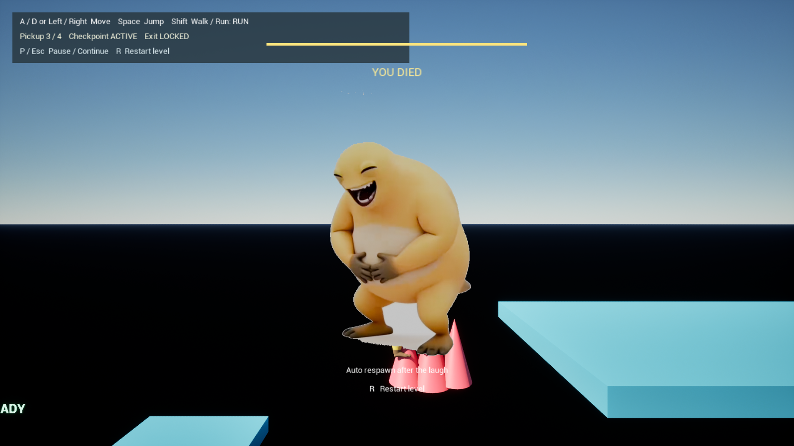

# 奶蛙冒险

横版闯关小游戏。主角奶蛙是「奶龙」的二创形象，非官方。

最早用 C++ / SFML 写了原型，现在用 UE5 重做。角色和每一颗蛋都由 Python 脚本在 Blender 里生成，改参数重跑就更新，不用手动雕。

## 玩法

### 1-1

四种机关：隐藏尖刺、弹跳板、限时平台、开关移动平台。8 个检查点，摔死就地复活，机关跟着复位。终点要先拿到指定的那颗拾取物。



### 2-1 / 2-2 / 2-3

打弹弓。奶蛙蹲左边，用奶蛋当子弹，把右边搭好的结构打塌，砸中目标蛋算赢。按住左键在蛋上拖出方向和力度，松手发射。

- **2-1 斩首**：一根细柱子顶着目标蛋，只有基础奶蛋。
- **2-2 选蛋**：五种蛋随便挑。
- **2-3 综合**：一座塔，得换着蛋打。

五种奶蛋：基础、奶鸡（飞行中再点一下往上窜）、奶鼠（再点一下裂成三枚）、豆奶（判定球更大）、奶茶（落地后四周炸开）。

结构块是真刚体，撞侧面会转，撞正中几乎不转，撞下沿往上弹。同一发打两次结果不会完全一样。

打空退你一颗蛋。蛋打光目标还在就判失败，按 `R` 重来。

## 运行

需要 UE 5.8，脚本默认从 `C:\Program Files\Epic Games\UE_5.8` 找引擎，装在别处加 `-Engine <路径>`。

```powershell
powershell -File UE5/launch_p1_v7.ps1          # 直接进 1-1，全高质量、无垂直同步
powershell -File UE5/launch_p1_v7.ps1 -Editor  # 打开编辑器
```

也可以直接用 UE 打开 `UE5/NaiwaP0/Nai_Long.uproject`。打包出来的包从主菜单进，选关按顺序解锁，进度自动存。

走路关：

| 按键 | 作用 |
| --- | --- |
| `A` / `D` | 左右移动 |
| `Space` | 跳 |
| `Shift` | 切换走和跑 |
| `R` | 重开本关 |
| `P` | 暂停 / 继续 |
| `Esc` | 回选关 |

跑是走的两倍速，有几个断口必须跑着过。

弹弓关：

| 按键 | 作用 |
| --- | --- |
| 按住左键拖 | 在蛋上拉出方向和力度，松手发射 |
| `1` – `5` | 选蛋，2-2 才全开 |
| 飞行中再点左键 | 奶鸡上窜、奶鼠分裂 |
| `R` | 重开本关 |
| `Esc` | 回选关 |

## 命令

```powershell
# 打包，产物在 UE5/NaiwaP0/Saved/DemoBuild*
powershell -File UE5/package_demo.ps1                  # Development
powershell -File UE5/package_demo.ps1 -Config Shipping # Shipping

# 单关物理回归
powershell -File UE5/run_p2_physics_level.ps1 -Level 2-1
```

```bash
# 重建角色模型，需要 Blender
python NaiwaCharacter/build_naiwa.py --from-primitives

# 重建五种奶蛋
python NaiwaCharacter/build_naiwa_egg_features.py

# 编 SFML 原型，早期练手版，已冻结
cmake -S . -B out/build && cmake --build out/build --config Release
```

每轮迭代目录里都留着 `rebuild_command.ps1` 和 `parameters.json`，可以单独复建那一轮并校验哈希。

## 目录

| 目录 | 内容 |
| --- | --- |
| `UE5/` | 主线。`NaiwaP0/` 是引擎工程，关卡和资产在 `Content/Naiwa/`，`P1/` 是平台关，`P2/` 是弹弓关，`UI/` 是主菜单；`SourceAssets/` 放音效贴图原素材；`Scripts/` 是建图、导入、验收脚本；`Records/` 是报告和日志 |
| `NaiwaCharacter/` | 建模流水线，`versions/` 按日期留了每一轮工程 |
| `NaiwaAnimation_20261009/` | 打招呼动画，工程加十秒成片 |
| 根目录 `.cpp` | SFML 原型 |

## 文档

| 文档 | 看什么 |
| --- | --- |
| [CHANGELOG.md](CHANGELOG.md) | 每轮做了什么，为什么这么选，放弃了什么 |
| [连闯与打包验证](UE5/Records/p2_campaign_validation_20261021.md) | P2 三关在最终包里跑通到什么程度，哪些没验 |
| [P1 工程报告](UE5/Records/P1_工程报告_20261018.md) | 1-1 的实现范围、验收结果、还剩什么没清 |
| [关卡结构图](UE5/Records/关卡结构图_v7_20261018.html) | 1-1 的段落、检查点、机关布局 |
| [P1 计划书](UE5/Records/P1_计划书_20261014.md) | 阶段怎么拆、按什么口径验收 |
| [P2 计划书复评](UE5/Records/P2_工程计划书复评_20261019.md) | 奶蛋闯关的结构与风险 |
| [UE5/Records/](UE5/Records) | 全部报告、运行日志、录像 |

P0 的[最终验收](UE5/Records/p0_completion_20261013/completion_report.md)、[接入过程记录](UE5/README_接入记录.md)、[主角接入清单](Naiwa_UE5_2.5D主角接入清单_20261010.md)、[角色流水线用法](NaiwaCharacter/README_使用说明.md)、[E2 形体修改指令](Naiwa_E2对照原图评估与整体修改指令_20261008.md)。

## 版权

「奶蛙」是基于「奶龙」的二次创作形象，和原作者及任何官方方无关。仓库内的参考素材、音乐版权归各自原作者，仅用于个人学习与创作。
