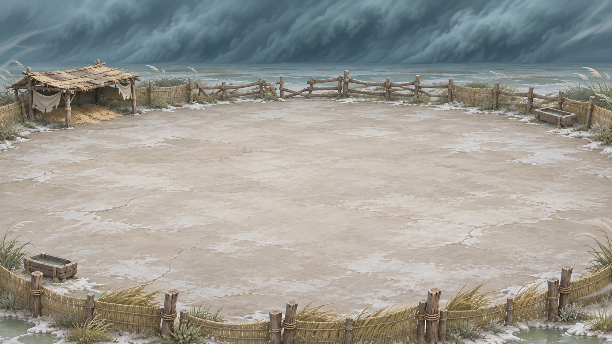
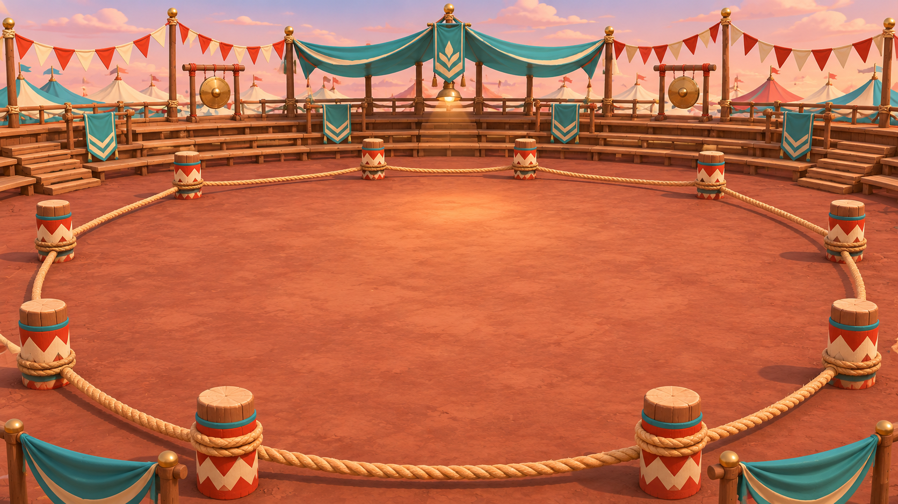
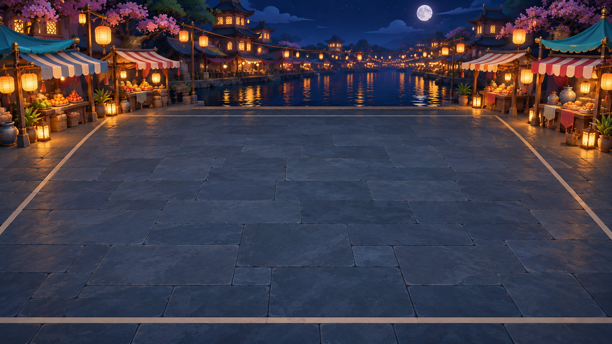
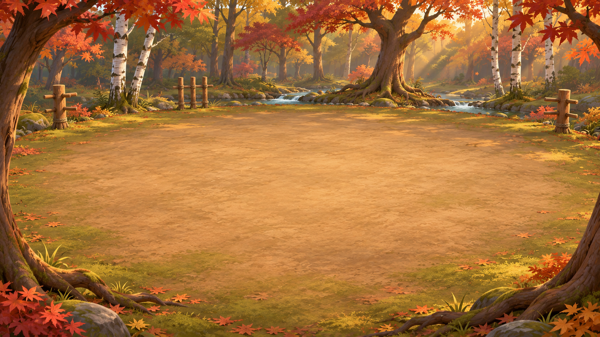

# P4 Beta 六章场景差异化重做 v02

日期：2026-11-11  
状态：**负责人已通过章 2–6 五张场景概念方向（2026-11-11）；五张独立正式背景源图已生成并导入 UE（2026-11-12），由工程负责主题绑定与固定机位可读性复核。运行时验收尚未完成。奶甲将军三视稿已于 2026-11-12 通过并作为美术参考导入。**  
变更依据：负责人要求“每一关场景要完全不一样，其他通过，场景重做”。

## 1. 范围与构图原则

- 章 1「沙丘晒笑场」保留已验收的 A2 沙漠石门场景作为 Alpha 基线。
- 重做章 2–6；每章使用独立空间结构、地表材质和主色，不复用章 1 的石门、石砖场地、旗帜布局，也不把同一场景仅作滤色变体。
- 所有章节只共享固定 3/4 俯视相机、安全的中场战斗净空和边界可读性；中央约 65% 区域保持平整、低噪点，保证角色脚底、红色攻击预警与 HUD 可辨。
- 本批是五个单独场景概念图。生成图待固定机位校验，不等同于 UE 实景或最终 1080p 交付。

## 2. 六章场景对照

| 章 | 场景构成 | 与其他章节的区别 |
|---:|---|---|
| 1 沙丘晒笑场 | 已验收沙色石门、石墙、浅灰绿石砖竞技地 | 保持 Alpha 基线，本轮不改。 |
| 2 沙丘补给线 | 悬在峡谷上的货运木平台、滑轮吊机、绳索和边缘补给箱；远景沙丘与黄昏天色 | 木质高空平台与垂直峡谷结构；没有石门、石砖地面和环形观众席。 |
| 3 沙暴猪圈 | 风暴盐碱围场、白灰硬地、低矮芦苇挡风墙、远处风暴带 | 平坦的浅色围栏场，天气和地表独特；没有峡谷、货台或建筑墙。 |
| 4 奶桶擂台 | 红土圆形竞赛场、粗绳边界、彩绘木桩、外围阶梯观众席和铜锣 | 环形竞技结构与红土；没有港口、货运滑轮、石门或水面。 |
| 5 沙丘夜市 | 运河旁的夜市石板步道、深蓝水面、两侧摊棚和灯笼倒影 | 夜间水岸与冷色板地；摊位光源在两侧，和木平台/红土擂台区别明显。 |
| 6 秋林校场 | 秋林空地、树干与红叶边框、练习木桩、远处溪流 | 自然林地与泥土地面、斜阳；没有人工石墙、市场、货运或看台。 |

## 3. 新场景图

### 章 2：悬崖补给平台

### 章 3：风暴盐碱围场

### 章 4：红土擂台

### 章 5：运河夜市

### 章 6：秋林校场

源路径、参考图、颜色空间、SHA-256 和状态见 [P4_Beta6_ArtDirection_manifest_v02.json](../../SourceAssets/P4/Manifests/P4_Beta6_ArtDirection_manifest_v02.json)。旧的五联沙漠色调板保留为 v01 历史稿，当前方向以这五张独立图为准。

## 4. 美术 WBS 影响

旧版预算将章 2–6 当作共用 A2 场景的模块变体。现在按五个独立场景重算：

| 工作包 | 更新估算 | 说明 |
|---|---:|---|
| 章 2–6 五套独立环境 | 18–30 人天 | 五张各自构图/材质/边缘资产，包含分层准备和各自的固定机位校图；不以滤镜换色替代主题制作。 |
| 六章 Beta 美术总量 | 195–307 人天 | 旧总量 189–297 人天替换原场景包 12–20 人天后，使用新场景包 18–30 人天重算。 |

上述总量仍为估算草案：敌人视图/动作矩阵和 WIP 可复用帧数尚待工程与 TA 核实。Beta 美术预算未在原计划中冻结，不能把本表视为外部艺术团队报价。

## 5. 进入生产的顺序

1. **已完成：**负责人通过五张单独场景概念方向，重点要求“每一关完全不一样”。
2. 按章节分别补可编辑源稿、背景/边缘道具分层、灯光色板与 manifest。
3. **已完成概念预览导入：**UE 为章 2–6 生成五张独立预览地图。概念图阶段结束。
4. **已完成正式背景生成和纹理导入：**五张独立正式背景源图见 [环境目录](../../SourceAssets/P4/Environment/Beta6/README.md)，UE 纹理及哈希见 [正式背景 manifest](../../SourceAssets/P4/Environment/Beta6/P4_Beta6_EnvironmentArt_manifest_v01.json) 和 [导入报告](evidence/Beta6/P4_Beta6_EnvironmentArt_import_report_v01.json)。工程侧负责章节主题绑定与 720p/1080p 固定机位可读性复核；美术侧按工程反馈修图。

UE 预览地图映射如下：

| 章 | 地图 | 场景纹理 |
|---:|---|---|
| 2 | `L_NaiwaP4_Beta6_02ScenePreview_v01` | `T_P4_Beta6_chapter_2_Scene_v02` |
| 3 | `L_NaiwaP4_Beta6_03ScenePreview_v01` | `T_P4_Beta6_chapter_3_Scene_v02` |
| 4 | `L_NaiwaP4_Beta6_04ScenePreview_v01` | `T_P4_Beta6_chapter_4_Scene_v02` |
| 5 | `L_NaiwaP4_Beta6_05ScenePreview_v01` | `T_P4_Beta6_chapter_5_Scene_v02` |
| 6 | `L_NaiwaP4_Beta6_06ScenePreview_v01` | `T_P4_Beta6_chapter_6_Scene_v02` |

构建报告：[P4_Beta6_ScenePreview_build_report_v01.json](evidence/Beta6/P4_Beta6_ScenePreview_build_report_v01.json)；UE 运行日志：[P4_Beta6_ScenePreview_engine_2026-11-12_10-05-18.log](evidence/Beta6/P4_Beta6_ScenePreview_engine_2026-11-12_10-05-18.log)。地图与材质均属于检查用预览，尚未进入最终生产交付。地图脚本在 [`p4_build_beta6_scene_previews.py`](../../Scripts/p4_build_beta6_scene_previews.py)，运行器在 [`p4_build_beta6_scene_previews.ps1`](../../Scripts/p4_build_beta6_scene_previews.ps1)。没有修改 Alpha 第 1 章地图或已通过的敌人/Boss方向稿。

