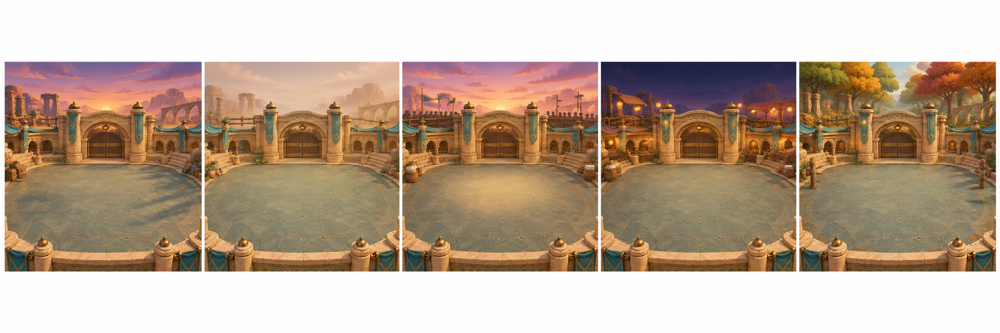

# P4 Beta 六章美术范围核对与首批方向评审 v01

日期：2026-11-11  
状态：**范围与初估留作 v01 历史记录；敌人和奶甲将军方向已通过；负责人要求场景重新设计。环境方向与场景预算以 [场景差异化重做 v02](P4_Beta6_场景差异化重做_v02_2026-11-11.md) 为准。**  
依据：[Beta 六章美术交接](P4_Beta六章美术交接说明_2026-11-11.md)、[Beta 六章工程交接](P4_Beta六章工程交接说明_2026-11-11.md)、[章节数据 v1](design_reference/P4_章节数据_v1.json)。

## 1. 本轮范围

六章总量包含已验收的 Alpha 第 1 章；本轮新制作第 2–6 章。第 7–10 章仍保留在完整十章计划内，暂不纳入此估算。第 1 章画面沿用现有 A2 v02，不重做已验收的视觉方向或 Alpha 奶蛙。

| 章 | 美术范围 | 角色 / Boss | 视觉重点与复用方式 |
|---:|---|---|---|
| 1 沙丘晒笑场 | 冻结，不新增场景 | 奶丁等 Alpha 首章内容；无 Boss | 直接沿用 A2 沙漠竞技场基线。逐波组成以已验收运行数据为准，不以旧 JSON 静默覆盖。 |
| 2 沙丘补给线 | 沙漠黄昏模块变体 | 奶丁、奶咒、奶瓶雷、奶跳、奶盾 | 橙紫天色、长投影；木箱仅作环境线索。重点检查冲撞后奶盾的位置、盾向与攻击窗口。 |
| 3 沙暴猪圈 | 低饱和沙漠变体 | 奶丁、奶咒、奶瓶雷、奶跳、奶盾、奶铃、奶锤 | 雾光和轻沙尘限于外围；角色、投射物和红色预警始终清楚。 |
| 4 奶桶擂台 | 沙漠擂台变体 | 奶丁、奶咒、奶瓶雷、奶盾、奶桶队长 | 围栏、低对比观众层和聚光；队长与奶盾剪影分开；冲锋、桶盖砸地和撞墙破绽可分别读出。 |
| 5 沙丘夜市 | 琥珀夜市变体 | 奶丁、奶咒、奶瓶雷、奶跳、奶盾、奶铃、奶锤、奶箱、奶霜、奶察、奶豪、奶蛋 | 灯笼和布摊放在边缘。奶箱要让玩家读到“像箱子、会咬人”，但不能混淆真实强化卡 UI。 |
| 6 秋林校场 | 秋林主题变体；复用共用地面和竞技场结构 | 奶丁、奶咒、奶跳、奶盾、奶铃、奶锤、奶甲将军 | 秋绿转红、斜后光、稀疏落叶和木桩。盾墙、三连斩、地波方向清楚；二阶段胸甲飞出不得盖住角色或血条。 |

### 六章角色总表（12 种）

| ID | 角色 | 首批动作差异点 | 当前美术基线 |
|---|---|---|---|
| naiding | 奶丁 | 轻快追击、扑击、受击与死亡 | 已批准概念；六状态板为 WIP，需清理、导出和锚点 QA。 |
| naizhou | 奶咒 | 远程瞄准/预警、直线施法；法术提示独立做 VFX | 新制；方向预览见下图。 |
| naiping_lei | 奶瓶雷 | 引信、膨胀/自爆专属姿势 | 新制；瓶状轮廓须区别于奶蛋。 |
| naitiao | 奶跳 | 下蹲蓄力、跳劈预警、落地 | 新制。 |
| naidun | 奶盾 | 正面防御、被冲撞顶开、盾牌分层 | 已批准概念；WIP 板待清理，左右侧需分别保持盾牌朝前。 |
| nailing | 奶铃 | 摇铃蓄力、范围震击 | 新制。 |
| naichui | 奶锤 | 慢动作蓄力、砸地回弹 | 新制。 |
| naixiang | 奶箱 | 静止伪装、揭盖露嘴、突袭 | 新制；须区别于可拾取奖励箱。 |
| naishuang | 奶霜 | 远程减速弹与施法前摇 | 新制。 |
| chacha | 奶察 | 巡逻、发现、呼援动作 | P3 行为复用候选；先查源路径、朝向/镜头和授权，再决定复绘或原路径引用。 |
| haohao | 奶豪 | 抛物线投掷前摇与收势 | P3 行为复用候选；先经 P4 镜头与造型审核。 |
| dandan | 奶蛋 | 滚动、引信计时、自爆 | P3 换皮候选；不得复制源图，须保留奶蛋的蛋形与滚动尾迹识别。 |

统一动作基线先按 W3 交接中的六类规划：idle、move、telegraph、attack、hit、death。奶咒、奶瓶雷、奶箱、奶蛋、奶察、奶豪需另补专属关键姿势。最终视图矩阵尚未由工程提供，因此以下帧数是估价基准，不是冻结交付量。

## 2. 复用差异与资产准入

| 资产 | 已有内容 | 本轮处理 | 估算是否计入节省 |
|---|---|---|---|
| 奶蛙 A1 | 33 帧视觉方向通过；有源帧与 UE 纹理 | 复用验收版；不拿 P3 静帧替换动作 | 计为复用 |
| A2 沙漠竞技场 | v02 源图 1672×941，UE 预览资产存在 | 第 1 章复用；第 2–5 章做材质/光照/边缘道具变体；第 6 章共享地面结构，新增林地背景和边缘套件 | 只计共享结构；未把五张独立大背景算作目标 |
| 奶丁、奶盾 | 已批准概念、正面预览和六状态 WIP | 先清理并核对格线、姿势、透明边、脚底和镜像；奶盾拆盾层 | **暂不抵扣逐帧生产工时**；通过帧级 QA 后再记可复用帧 |
| 奶桶队长 | 26 张导入 UE 的 WIP 预览；已有待机/若干双姿势 | 保留为造型/动作参考；贴地冲锋出击帧曾被移除，正式替代姿势未完成 | **不按 26 张生产帧抵扣** |
| W4 公共战斗特效 | 57 张已导入预览；来源仍是 RuntimeWIP | 按工程事件核对可用序列；补 Boss 6 地波、斩击/盾墙、胸甲反馈等差异项 | 仅视为候选 |
| HUD / 卡面 | 3 个 Alpha 卡图标、3 个类别标记、HUD/卡面版式方向通过 | 复用版式、类别形状和已有图标；逐一核对 16 张 Beta 卡的显示池，暂按最多补 13 张专属图标估价 | 需卡池清单确认后锁量 |
| 奶察、奶豪、奶蛋 P3 行为 | 设计基线注明行为复用/换皮 | 只做候选映射，记录原 UE 路径和试用结果；不复制源文件、不改 P3 源资产 | 暂不抵扣 |

## 3. 暂估 WBS 与工时

口径为 P4 计划定义的 1 人天 = 6 小时有效工作。唯一可用生产率参照是 Alpha A1 初估：单个独特帧 0.2–0.3 人天，另计图集/锚点处理。此处没有把 Beta 工程 32–52 人天按章节比例换算成美术工时。

| 工作包 | 估算依据 | 人天（暂估） |
|---|---|---:|
| 方向与概念评审 | 12 敌剪影表、奶甲将军设定、五个新章节主题色稿及一次方向收敛 | 3–5 |
| 12 种敌人帧生产 | 暂按每敌 16 个独特姿势/视图 × 3 视图；奶盾增加 side_left 16 帧，共约 592 帧。592 × 0.2–0.3 人天；再加每角色 atlas、导出、锚点和 Alpha QA | 127–194 |
| 奶桶队长生产收口 | 现有 WIP 仅作参考；补正式冲锋动作并完成九类状态需要的生产帧、分层、清理 | 8–14 |
| 奶甲将军 | 全新造型/转面、分层装备、至少九类状态关键动画与胸甲反馈 | 15–24 |
| 章节环境 | 章 2–5 沙漠模块变体、章 6 林地变体，共用地面；色调、边缘道具、光照与固定机位 QA | 12–20 |
| 战斗 VFX | 审核 Alpha/W4 候选；为章 4/6 Boss 预警、出招、命中和阶段反馈补齐必要短序列 | 8–14 |
| 卡牌与字幕呈现 | 最多 13 个缺失图标的估价、已有卡面版式适配、六章实际字幕 ID 的换行/时长检查 | 4–8 |
| 美术 TA 与交付包 | manifest、可编辑源稿归档、图集和独立帧导出、720p/1080p 固定机位复核、UE 纹理导入设置和证据 | 12–18 |
| **本轮总估算** | **方向已考虑生产；不含第 7–10 章新增资产、配音制作或菜单入口美术** | **189–297** |

这是一份高不确定性的全量生产范围估算。敌人基线沿用 W3 的 16 帧/视图提案；逐敌视图矩阵、动作时长/关键事件、12 个角色实际可复用的 WIP 帧和 16 卡实际展示池尚未冻结，都会改变总量。现有 WIP 未经过逐帧 QA 前不虚报工时节省。工程给出显示视图/状态矩阵后，先重算帧数，再冻结合同预算。

## 4. 首批方向预览（角色方向已通过；旧场景稿已被替换）

这些图是图像生成的单张概念评审图，没有分层源稿，没有独立帧、锚点或 UE 导入数据。只供选方向；不得当作 Sprite、宣传成品或 RuntimeReady 资产。

### 敌人形状方向

本稿分别测试：奶咒的高窄施法轮廓、奶瓶雷的瓶身/引信轮廓、奶箱的木箱伪装轮廓。奶盾仍以已批准的 Naidun turnaround 为准，不在本稿里重画。注意奶瓶雷目前采用偏珊瑚色；若要与奶蛋更易区分，建议冻结色相前做缩小剪影盲测。

### 奶甲将军方向

本稿给出了高于奶盾的统领剪影、盾牌和短刀轮廓，以及胸甲分件飞出的阶段提示。头盔羽饰偏大、角色偏武将人形，胸甲第二姿势目前容易读成穿戴拆分；需确认这是否符合奶家角色的可爱比例，再进行正背侧转面和拆件设计。

### 章 2–6 环境色稿

本稿展示模块化同场地的五个色调方向。章 3 的沙尘目前还偏轻；章 2/4/5 仍需保持中央净空。正式制作时应以运行时相机图校验，不沿用此联系表的分幅构图作为最终地图。

### 预览文件

| 文件 | 状态 | SHA-256 |
|---|---|---|
| p4_beta6_enemy_concepts_v01.png | concept preview / 待审 | 3F9F0BEF61720FC0191CF023F3B9C1C0C80CD30FB0E962D0BBC5B5181294B70D |
| p4_beta6_boss_nai_jia_v01.png | concept preview / 待审 | 0A9FEEFE0522365782F21DA0C3B7F694A5E5C7042FD163CEF180E482DDF0A27C |
| p4_beta6_arena_color_study_v01.png | concept preview / 待审 | 7162809B49C6A9205E1FB4CA2C5143F4D459DD41E5BC8804EA8D45631F23D218 |

清单同步记在 [P4_Beta6_ArtDirection_manifest_v01.json](../../SourceAssets/P4/Manifests/P4_Beta6_ArtDirection_manifest_v01.json)。

## 5. 批次建议

1. 先审方向：奶瓶雷颜色/瓶体大小、奶箱与真实强化箱的区别、奶甲将军是否太像人形武将、章 3 沙尘强度和五张背景的中心对比。
2. 工程补齐每个敌人/Boss 实际需要显示的视图、动作事件 ID、攻击锚点和 HUD 安全区。此矩阵会直接改动第 3 节的帧数预算。
3. 冻结 WBS 与视图矩阵后，先做章 2：场景材质/道具变体，加奶丁与奶盾的两种常见动作生产批；并把奶桶队长正式替代姿势导入独立预览图校机位。
4. 首个 UE 预览通过脚底、占屏、遮挡和预警对比后，再扩至其余章节、敌人、Boss 与 VFX。

## 6. 明确边界

- Beta 六章交付不取消完整十章范围；章 7–10 维持总计划。
- Chapter 1 的 20 只和旧 JSON 波次描述有差异，以已验收 Alpha 运行数据为准，不在美术侧改战斗表。
- 不编辑 P2/P3 原资产、共用 C++、默认 GameMode 或全局存档布局；外部项目资源仅按原路径评审引用。
- 负责人体验验收不替代 Beta 的批次视觉签收；本批次图像均保持 concept preview/WIP，直到收到方向确认和工程镜头条件。

