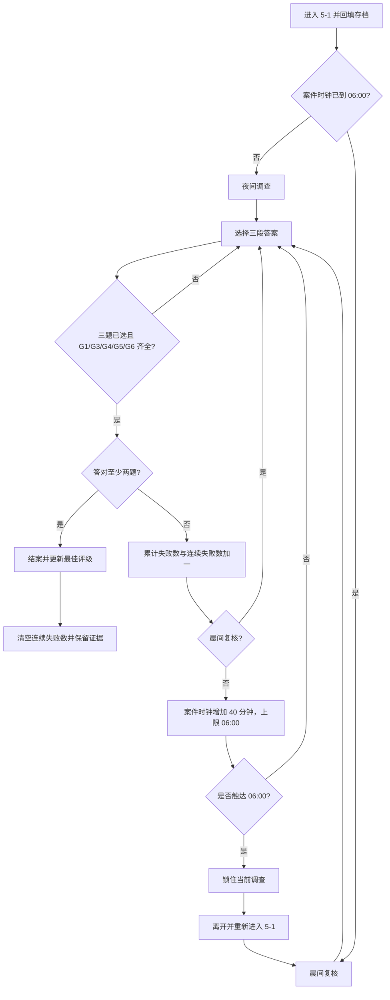

# P6 M4 三段结案工程切片

日期：2026-11-11（Asia/Shanghai）  
范围：在既有 P6 M2 大院灰盒与 M3 信息层/皮肤实现上接入三段提交、失败时钟与最小持久评级。本文记录的是代码切片，不代表 M4 出口门或 P6 完整结局已通过。

## 本轮实现

- `FNaiwaP6CaseDefinition` 现提供三条题目、选项、所需通用证据和评分接口。答案 ID 保存在定义实现文件的内部问题行中，HUD 只读取题干/选项，不读取正确项；评分会拒绝不属于对应题目选项的 ID，避免结构性无效输入记成错答；`GetFirstQuestionText/Options` 保留为旧接口适配，M1/M2 入口不需同步改名。
- 线索板使用 `Q/E` 浏览题目、`1–4` 为当前题选择、`Enter` 一次提交三题。每题答案保留在当前 WorldSubsystem 会话，离开后重进会清空选择；提交前不显示正确/错误颜色。
- 每次整组提交前，必须已选满三题并收齐 G1、G3、G4、G5、G6。S1–S4、X1/X2 是额外调查线索，不会变成某个皮肤专属的结案门；按规则，基础款和四种皮肤都能使用同一组 G 卡走完整题目骨架。此为代码覆盖检查，不是五种配置的游戏内验收。
- 三题的证据门分别为：奖杯接触结论依赖 G5；检测仪采样结论依赖 G1+G3；口供时间线结论依赖 G4+G6。整组提交时校验三组都满足。
- 3/3 记录完美评级 2；2/3 记录可结案评级 1；0–1/3 不结案，证据与当前答案选择保留，允许调整后再提交。失败三次后只提示回看 G5 的接触痕迹及 G1/G3/G4/G6 的时间/装置记录，不给出答案 ID。
- 未选满三题或尚缺核心证据时只显示阻塞原因，不记失败、不推进案件时钟；证据门按题目顺序列出当前缺少的 G 卡 ID，便于继续调查。
- 案件时钟从 00:20 开始；失败提交将累计数与连续失败数分别加一，06:00 前时间增加 40 分钟，时钟上限为 360 分钟。连续失败达到 3 次后只提示复核线索；任意成功结案会清空连续失败数但保留累计数。触达 06:00 后夜间结案流程锁住选择/提交，但仍可查看或收集线索；离开并重新进入 5-1 后进入晨间复核，之后失败不再推进时间。重进保留通用/皮肤/组合证据、失败计数、案件时钟和最佳评级。
- 主存档新增 `P6WrongSubmissionCount`、`P6FailureStreakCount`、`P6CaseElapsedMinutes` 和 `P6BestCaseRating`，DataVersion 迁移到 6。保存时钟限定在 20–360 分钟、最佳评级为 0–2。未保存题目选择或本次结案标志；重进可以再次复核，并可提升最佳评级。
- HUD 顶栏显示线索/必看点进度；夜间显示案件时刻/失败次数，夜间、暂停、晨间与结案状态均显示存档最佳评级。线索板显示当前题、已选数量、最近提交反馈和晨间/结案状态；大院主线必看提示仍保留。完整的首通奶票奖励、奖励幂等键、结案演出和正式 ending 不属于本切片。
- 晨间重进目前只切换到“晨间复核”逻辑/界面状态，不包含清晨地图灯光、场景改版或额外对白；需要 M4/M5 后续内容实现与验收。

## 输入

| 输入 | 行为 |
|---|---|
| `WASD` / 方向键 | 在院内移动 |
| `Space` / `J` / 鼠标左键 | 检查附近点位 |
| `Tab` / `F` | 切换皮肤 / 显示对应的信息层 |
| `C` | 打开/关闭线索板 |
| `Q` / `E` | 线索板中上一题/下一题 |
| `1–4` | 选择当前题的一个答案 |
| `Enter` | 校验证据并提交三段答案 |
| `Esc` | 返回选关页 |

## 当前状态流

## 持久状态与边界

- 已收集线索由既有 `P6CollectedClueIds` 存档，不因错答或晨间重进丢失。
- 点位访问计数仍是单局状态；到晨间复核时，HUD 改显示证据数与案件状态，并提示可直接提交，不会把重置后的点位数显示成 `0/9` 夜间路线进度。
- 失败次数、案件时钟和最高评级存入共用菜单存档；题目作答和当前世界的结案/06:00 暂停标志只在会话内。
- `NaiwaP6M1Probe` 至 `NaiwaP6M4Probe` 命令行模式不应写入玩家存档；新存档字段迁移也沿用探针只读保护。
- 旧第一段提交 API 仍存在，供既有 M1/M2 GameMode 探针与调用路径兼容；新的玩家 HUD 不再调用它。
- 奖励尚未写入奶票或关卡完成记录，因此本切片不会提前开放后续关卡，也不会发放重复奖励。

| 配置 | 共用目录 ID | M3 信息层 | 三段结案证据门 |
|---|---|---|---|
| 基础款 | `NaiwaSkin_Base` | 无专属 S 卡 | G1、G3、G4、G5、G6 |
| 奶察 | `NaiwaSkin_NaiCha` | S1 | G1、G3、G4、G5、G6 |
| 奶杀 | `NaiwaSkin_NaiSha` | S2 | G1、G3、G4、G5、G6 |
| 奶豪 | `NaiwaSkin_NaiHao` | S3 | G1、G3、G4、G5、G6 |
| 奶雨 | `NaiwaSkin_NaiYu` | S4 | G1、G3、G4、G5、G6 |

## 检查状态（2026-11-11 首版切片时）

- 静态审阅覆盖三题数组尺寸、答案 ID 与选项匹配/无效 ID 拒绝、必需证据门、失败分钟数/06:00 钳位、重进时的数据回填、累计/连续失败区分、最佳评级只增不降、答案选择不进存档，以及旧接口仍保留。
- 五次尝试 `Nai_LongEditor Win64 Development` 增量构建（后四次针对更新后的源码）；`Build.bat` 均只返回“already running, waiting for existing script to terminate”。后四次等待约 6–8 分钟后仍无编译输出，已中断本任务发起的等待；没有确认互斥锁持有者、绕过锁或得到编译结果。日志见 `editor_build_2026-11-11.log`。
- 没有运行自动测试/探针、PIE、存档实写或人工试玩；没有验证 3/3、2/3、0–1/3、三次失败、06:00、晨间复核或五种皮肤的真实运行路径。
- 尚缺 M4 完整奖励与幂等、结案动画/ending、正式视觉资源和包内回归。M2 步行可达性、M3 局部遮挡/可见性与双分辨率 HUD 等既有出口门也仍待实际验收。

## 相关文件

- `UE5/NaiwaP0/Source/NaiwaRuntime/P6/Data/NaiwaP6CaseDefinition.h/.cpp`
- `UE5/NaiwaP0/Source/NaiwaRuntime/P6/Core/NaiwaP6InvestigationSubsystem.h/.cpp`
- `UE5/NaiwaP0/Source/NaiwaRuntime/P6/Presentation/NaiwaP6PlayerPawn.h/.cpp`
- `UE5/NaiwaP0/Source/NaiwaRuntime/P6/Presentation/NaiwaP6HUD.cpp`
- `UE5/NaiwaP0/Source/NaiwaRuntime/NaiwaMenuProgress.h/.cpp`
- [P6 工程计划书](../p5_p6_plan/P6_工程计划书_v2.md)

## 2026-11-12 接续记录

- 后续共享主工程构建提供了 M4 源码的构建证据：`../p7_td/evidence/P7_MainNaiLongGameBuild_2026-11-11_23-06-56.log` 的 `Nai_Long Win64 Development` 构建以 105 个动作成功结束，并实际编译 `NaiwaP6CaseDefinition.cpp`、`NaiwaP6InvestigationSubsystem.cpp`、`NaiwaP6HUD.cpp`、`NaiwaP6PlayerPawn.cpp` 等 P6 源文件。这修正了本文前述“没有确认编译结果”的状态；该记录只覆盖 M4 奖励接入之前的源码，不等于 Editor、PIE 或结案流程验收。
- 本轮将结案奖励接入主存档：普通结案首次奖励 60 张奶票，首次达到完美评级再奖励 60 张，之后每个新调查轮次成功结案奖励 20 张。评级奖励键与以 WorldSubsystem 生命周期 GUID 生成的轮次键一同写入 SaveGame；同一轮次重复调用不会重复发票。无效评级或无效 GUID 不会发放奖励。
- 结算口径：首次 2/3 结案发 60 张；首次 3/3 结案发 120 张；先以 2/3 结案、之后首次提升至 3/3 时，该轮获得 60 张完美档补发票与 20 张成功重玩票；之后每个新轮次成功结案发 20 张。相同轮次 GUID 再次提交为 0 张。
- `UNaiwaMenuSaveGame` 新增 `P6ClaimedRewardKeys`，数据版本升到 7。旧存档若已有结案评级，迁移时按已有最佳评级补记一次对应首通奖励，票数和奖励键在同次保存中写入。
- 结案反馈显示实际到账奶票，并区分最佳评级提升或保持不变。2026-11-12 共用 Editor 构建记录 [shared_editor_build_2026-11-12_reward_keys.log](shared_editor_build_2026-11-12_reward_keys.log) 使用 P7 ArtReview 临时 `.uproject`，`Nai_LongEditor` 目标以 110 个动作成功结束，并编译了 `NaiwaMenuProgress.cpp` 与全部 P6 运行时代码。它证明了共用模块中的奖励键初版可编译，不等同于主 P6 `.uproject` 的 Editor 构建或游戏内验收。
- 结案后的线索板新增案情复盘文案：玩家成功提交后才揭示奶鸭碰倒奖杯、芯片循环播放笑声及检测仪误判，提交前不会显示这段真相；结案后仍可用 Q/E 回顾题目，页脚提示按 C 返回院子。`FNaiwaP6CaseDefinition::DefinitionVersion` 升到 5。此为文本揭晓切片，仍不包含奖杯/芯片动画、村民笑场或正式 ending。
- 奶票写入会在 `int32` 钱包上限处安全饱和，结案反馈返回实际加到账户的票数，避免在余额已满时显示虚报金额。
- 随后的 [strict idempotency 增量构建](shared_editor_build_2026-11-12_reward_idempotent.log)仍使用 P7 ArtReview 临时 `.uproject`，以 4 个动作成功结束并重编 `NaiwaMenuProgress.cpp`；这确认了严格重复 GUID 早退分支可编译。主 P6 `.uproject` 的构建依旧在排队等待。
- 11/12 10:57 的另一条共享 `Nai_LongEditor` 记录使用同一 P7 临时 `.uproject`，5 个动作只编译 `NaiwaP7Simulation.cpp`、`NaiwaP7GrayboxHUD.cpp` 并链接 P7 模块；本轮没有编译 P6 源码。快照见 [P7-only 日志](shared_editor_build_2026-11-12_p7_only.log)。它不覆盖此后源码修改，也不代表主 P6 `.uproject` 构建成功。
- 16:02 的 `Nai_LongEditor` 构建使用 `Nai_LongP7ArtReview_TEMP.uproject`，生成 34 个动作并编译了 `NaiwaMenuProgress.cpp`、P6 HUD/Actor/Subsystem；随后在 `NaiwaP6InvestigationGameMode.cpp:384` 因 C4458（局部变量 `Layers` 隐藏 `AActor::Layers`）失败。现已将局部变量改名为 `InfoLayers`。这是定位当前源码问题的临时工程编译，不是主 P6 `.uproject` 构建通过证据；原始日志见 [P7 临时工程编译诊断](shared_editor_build_2026-11-12_p7_temp_p6_probe_compile_fail.log)。
- 之后新增了实际到账票数饱和处理、最佳评级实际变化反馈、结案后案情复盘和 HUD 提示，均晚于上述共享构建证据；它们尚未获得对应编译结果，需在锁释放后由主 P6 工程构建确认。
- 主项目 `Nai_LongEditor` 构建仍在等待 `Build.bat is already running, waiting for existing script to terminate...`；日志 `editor_build_2026-11-12_rewards_idempotent.log` 尚未记录编译动作。该等待没有绕过文件锁；严格 GUID 修订已由 P7 临时 `.uproject` 增量编译，但主 P6 工程尚未确认其配置及后续 HUD/奖励精度修订。本轮未运行自动探针、PIE 或存档实写。
- 仍待完成：3/3、2/3、失败/06:00/晨间流程的运行验证、正式奖励 UI 与主菜单奶票同步检查、M2 可达性试玩、A0–A5 资产集成、结案动画/表演与正式 ending。

## 2026-11-12 M3/M4 探针入口接续

- `UE5/run_p6_m1.ps1 -Mode ProbeM3` 新增 M3 运行入口。它检查 14 个 M2 点位与 12 张线索容量、四个唯一的 S1–S4 信息层、Trophy 点位上的显示/收集与关闭、X1/X2 组合归档、五行共享皮肤目录，以及每局最多两次皮肤切换。探针结束前核对共用存档中的线索、奶票、失败/连续失败计数、时钟和最佳评级没有变化。
- `UE5/run_p6_m1.ps1 -Mode ProbeM4` 分别启动 Perfect、Clear、Failure、Morning 四个 `UnrealEditor-Cmd` 场景，写出带运行时间戳的分场景 JSON、日志和聚合 `m4_probe_result_<timestamp>.json`。断言覆盖结案前复盘状态关闭、3/2/1/0 分与无效答案 ID、缺核心证据不计错/不推进时间、三次失败提示、九次失败触达 06:00 并锁夜间提交、晨间失败不推进时钟且可成功结案，以及共用存档字段不变。探针另用新建的内存 SaveGame 检查首个普通结案 60、首个完美结案 120、普通档后提升完美档 80、之后结案 20、同 GUID 重复提交不更新评级/失败连击/票数、非法评级/GUID 拒绝和钱包上限的精确到账数。
- M4 的地图构建报告/日志使用带运行时间戳的文件名写入 `Records/p6_m4/`，与既有 P6 M1 和先前运行 evidence 分开保存。
- 同一脚本现在会把 Editor 与 Game `Build.bat` 的标准输出和错误输出分别 tee 到带时间戳的 `m4_editor_build_*.log` 与 `m4_game_build_*.log`，构建失败信息会指向相应日志。
- Morning 场景在 P6 WorldSubsystem 中用瞬态 fixture（累计失败 8、连续失败 2、时间 360 分钟、最佳评级 1）初始化，不依赖存档计数。P6 线索/结案写入在 `NaiwaP6M3Probe` / `NaiwaP6M4Probe` 下关闭；SaveGame 初始化迁移也不会调用 `SaveProgress`。报告将 `user_save_slot_touched` 标记为 `false`。
- PowerShell Parser 已解析 `run_p6_m1.ps1`，UE 随附 Python 解释器也成功解析建图脚本 AST；`git diff --check` 对已跟踪修改通过，另对新脚本和探针 C++ 做了逐行空白审阅。探针尚未运行，当前源码也尚未编译：主 P6 Editor `Build.bat` 调用仍在等待共享锁，日志没有编译动作。探针断言不能据此视为运行通过；当前等待过程与环境允许的锁诊断见 [构建等待记录](editor_build_2026-11-12_m3_m4_wait.log)。
- 快速入口：`powershell -File UE5/run_p6_m1.ps1 -Mode ProbeM3`、`powershell -File UE5/run_p6_m1.ps1 -Mode ProbeM4`；已有当前源码构建产物时可加 `-SkipBuild`。脚本默认先构建，再刷新/验证灰盒地图，然后运行探针。新探针及地图建图报告均带运行时间戳，避免覆盖既有 M1/M3/M4 结果。
