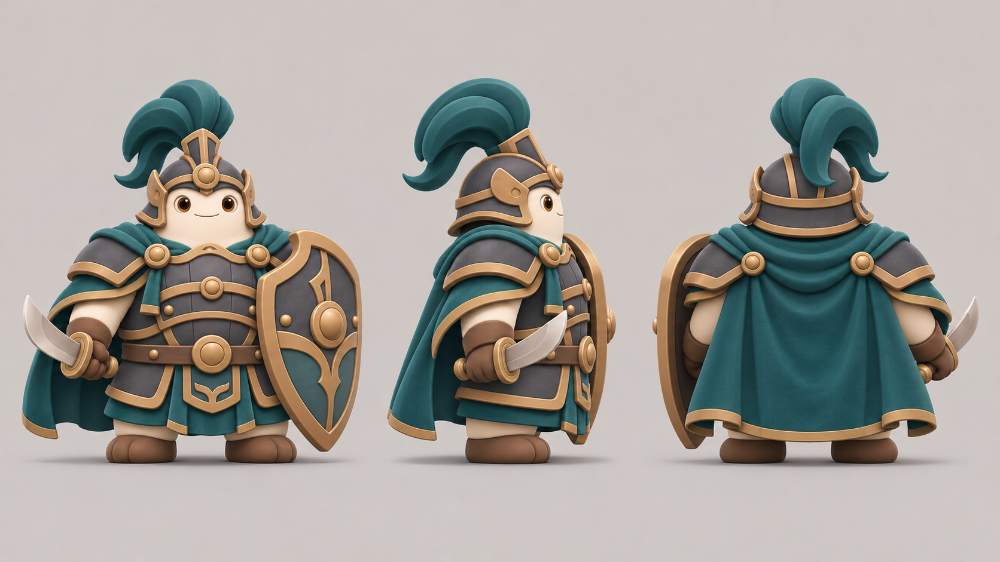

# 奶甲将军三视设定 v01

日期：2026-11-12  
状态：**三视美术参考已于 2026-11-12 通过并导入；不是运行时角色贴图。**

本稿依据已通过的奶甲将军方向图，补正面、右侧和背面三个一致尺度视图，便于后续拆装备和逐帧制作。保留象牙白圆身、深灰甲片、金铜包边、青绿色披风与高翘头盔羽饰、盾和弯刀。当前只供角色生产参考，不包含攻击/受击/召盾/脱甲/死亡动作。

UE 参考纹理：`/Game/Naiwa/P4/Art/Beta6/Characters/Reference/T_P4_Beta6_boss_nai_jia_turnaround_v01`。源图哈希和导入设置见 [manifest](P4_Beta6_BossNaiJiaTurnaround_manifest_v01.json)，导入报告见 `UE5/Records/p4_alpha/evidence/Beta6/P4_Beta6_BossNaiJiaTurnaround_import_report_v01.json`。

后续生产动作帧等工程侧冻结 Boss 动作/时序矩阵后再制作；本文件不代表负责人已通过三视细节或运行时验收。
