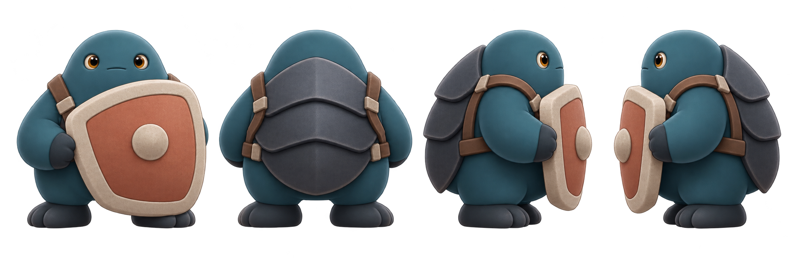

# Beta6 敌人三视设定 v01

日期：2026-11-12  
状态：**12/12 种敌人的静态三视参考均已导入并通过负责人审阅（2026-11-12）；奶丁、奶盾沿用 P4 Alpha 已有三视概念稿。全部为静态美术参考，不是运行时角色。**

奶咒、奶瓶雷、奶箱三视稿沿用已通过的 Beta6 敌人概念方向：尖帽卷轴、玻璃奶瓶/未点燃引信、木箱眼缝分别保留。奶跳、奶铃、奶锤根据 Beta6 敌人表的“弹簧腿”“项圈铃铛”“巨锤拖地”剪影提示补出；章5奶霜、奶察、奶豪、奶蛋按各自特征提示设计。所有稿均为静态正面/右侧/背面参考，不包含攻击时序、预警或碰撞表现。

## 奶咒

## 奶瓶雷

## 奶箱

## 奶跳

## 奶铃

## 奶锤

## 奶霜

## 奶察

## 奶豪

## 奶蛋

## 奶丁（沿用 P4 Alpha 三视概念）

## 奶盾（沿用 P4 Alpha 三视概念）

UE 参考纹理均位于 `/Game/Naiwa/P4/Art/Beta6/Characters/Reference/`。奶咒/奶瓶雷/奶箱的源哈希和状态见[初始三视 manifest](P4_Beta6_EnemyTurnarounds_manifest_v01.json)及[导入报告](../../../../../Records/p4_alpha/evidence/Beta6/P4_Beta6_EnemyTurnarounds_import_report_v01.json)；奶跳见[奶跳 manifest](P4_Beta6_NaitiaoTurnaround_manifest_v01.json)及[导入报告](../../../../../Records/p4_alpha/evidence/Beta6/P4_Beta6_NaitiaoTurnaround_import_report_v01.json)；奶铃/奶锤见[章3三视 manifest](P4_Beta6_Chapter03EnemyTurnarounds_manifest_v01.json)及[导入报告](../../../../../Records/p4_alpha/evidence/Beta6/P4_Beta6_Chapter03EnemyTurnarounds_import_report_v01.json)。

奶霜/奶察/奶豪/奶蛋的源哈希及导入状态见[章5三视 manifest](P4_Beta6_Chapter05EnemyTurnarounds_manifest_v01.json)及[导入报告](../../../../../Records/p4_alpha/evidence/Beta6/P4_Beta6_Chapter05EnemyTurnarounds_import_report_v01.json)。

奶丁/奶盾沿用 Alpha 三视概念稿；Beta6 UE 参考纹理、源哈希及导入状态见[核心敌人三视 manifest](P4_Beta6_CoreEnemyTurnarounds_manifest_v01.json)及[导入报告](../../../../../Records/p4_alpha/evidence/Beta6/P4_Beta6_CoreEnemyTurnarounds_import_report_v01.json)。

三视细节由负责人确认后，再根据工程冻结的动作矩阵制作运行帧。本批不代表角色行为或运行时可读性验收。
